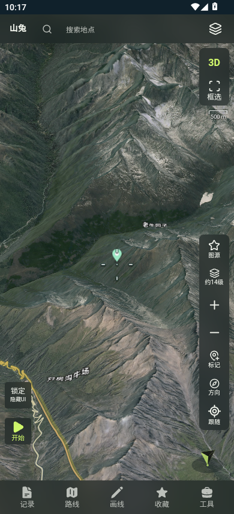
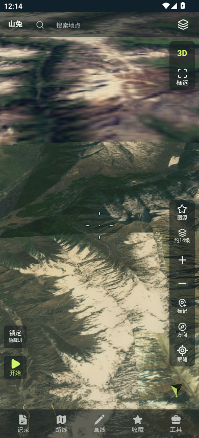
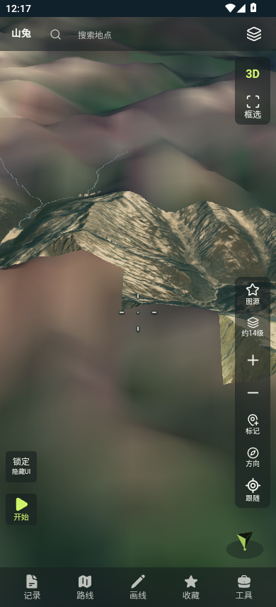

# MuMu实测：网页141与原生142

2026-10-29，按用户要求使用网易MuMu，比较精确已交付私人APK。结果是模拟器观测，不代表OPPO Find X8真机验收。前一份Google Android Emulator失败记录保留；本次换用MuMu完成测量，不表示原Google模拟器故障已经修复。

## 包和环境

| 项目 | 网页地图版 | 原生地图版 |
|---|---|---|
| 版本 / versionCode | 0.2.141-test / 148 | 0.2.142-test / 149 |
| 地图 / 界面 | MapLibre / React | WorldWind / React |
| APK大小，字节 | 70,306,068 | 180,488,627 |
| SHA256 | `ca3d673a58846d70fe98ff89165d5c9e0eabbe7d9f78d36b89cedda19b5660ad` | `7833d6fa8c60c52b9b1ee8b76d07e4b24e2ba959c6597249c7e4cd242b2317c4` |

同包名`com.guanyun.weather.shantu.preview`、原签名，依次覆盖安装到新建的MuMu实例3 `Shantu-Web141-Native142-Benchmark`。既有实例0–2、原Androws、手机和真实用户存档保留。MuMu已存在于本机，核验网易有效签名后直接使用，未重复安装。

MuMu主程序版本5.30.1.3586，管理CLI版本5.23.0.3181；Android 12L / API32 / x86_64，4虚拟核、4GiB RAM、Vulkan渲染、最高60FPS。物理渲染尺寸390×857、160dpi，应用可用CSS视口390×833，不能等同Find X8的1256×2760实际渲染负载。系统WebView110.0.5481.154.1。

## 统一场景与采集口径

- 主图、中心102.9°E/31°N、zoom12、bearing0；天地图影像/自动注记、高清、道路和地名开启、地形开启/夸张1。分别测俯仰0°与55°。0°也保留地形，不称为关闭地形的纯2D。
- 顺序为原生第一轮→网页第一轮→网页第二轮→原生第二轮；最后一轮前MuMu曾停止，重新启动相同实例。覆盖安装保留测试缓存，不清用户数据；网络、瓦片缓存与宿主调度没有完全隔离，所以不据此比较冷缓存下载速度。两种引擎的细节选择/画面外观存在差异，本表比较同用户设置下的交付应用，不声称像素和实际瓦片工作量完全等同。
- 每场景完成配置后强停并冷启动原始APK，启动期5次采样；随后静置4次、连续32次左右拖动、停止后4次。拖动为设备端单一shell连续执行500ms swipe，采样并发进行，不在手势之间插入遥测等待。两版各两轮；第二轮3D拖动后另静置约一分钟。
- 配置阶段临时开启WebView调试，以核实相机、图源和画质；测量前再次冷启动，检查主进程maps无Frida映射，观察记录均为`instrumented:false`。APK未重签/修改。网页设置阶段记录loaded与areTilesLoaded；原生设置阶段记录nativeReady，画面另以截图核对。nativeReady不等于网络请求全部完成。
- 内存为`/proc/<pid>/smaps_rollup`的主进程加所属WebView renderer的PSS，单位MiB。包含React UI renderer，不能只比较地图宿主；不包含全部宿主GPU/模拟器开销。RSS同时留档，不能把RSS共享页简单相加当独占内存。
- CPU为相邻有效样本的进程utime+stime差分，`CLK_TCK=100`已查询，PID集合变化的窗口排除。表格是按窗口时间加权的均值，**100%表示四个虚拟核全部占满**，不是单核100%口径。包含启动/加载工作的阶段另列，避免与稳定空闲混淆。
- 使用SurfaceFlinger timestats的实际地图呈现层：网页MainActivity窗口，原生NativeReactActivity的SurfaceView。FPS是该层呈现FPS；慢帧为present2present直方图≥54ms桶占比，非Android deadline jank率。不同层的gfxinfo不能直接比较，因此只留作辅助。
- 相同32手势实际耗时约19–29秒，SF实际窗口约18–26秒，原始起止时间与帧数留档。原生第二轮更长的手势执行窗口也体现调度差异；不把各轮帧数直接相减当作性能倍数。网页跨轮FPS波动明显，保留两轮数值，不只选择最高FPS；样本数量不足以推出稳定的机型排名。

## 实测结果

两轮均完成，共238次有效进程内存采样；所有场景检查32次连续手势、所属renderer与无注入记录通过。表中CPU为四核归一化时间加权均值，PSS分别给出中位数和采样峰值，不是分配总量。

| 版本/轮次 | 俯仰 | 拖动PSS中位/峰值 MiB | 拖动CPU均值 | 地图呈现FPS | ≥54ms慢帧 | SF窗口秒 |
|---|---|---|---|---|---|---|
| web141-r1 | 0° | 296.9 / 307.0 | 47.1% | 45.4 | 1.9% | 18 |
| web141-r1 | 55° | 315.8 / 337.6 | 43.8% | 21.2 | 26.3% | 20 |
| web141-r2 | 0° | 308.7 / 312.9 | 44.2% | 23.8 | 21.9% | 20 |
| web141-r2 | 55° | 306.6 / 327.4 | 45.1% | 30.3 | 11.3% | 18 |
| native142-r1 | 0° | 419.5 / 492.1 | 70.0% | 29.4 | 12.8% | 19 |
| native142-r1 | 55° | 502.2 / 575.5 | 54.8% | 11.1 | 56.2% | 19 |
| native142-r2 | 0° | 381.0 / 561.6 | 69.5% | 18.7 | 23.4% | 21 |
| native142-r2 | 55° | 401.9 / 473.2 | 58.7% | 6.5 | 72.8% | 26 |

第二轮拖动后延长静置：

| 版本 | 首末采样间隔 | PSS起点→终点 / 峰值 | CPU均值 |
|---|---|---|---|
| web141-r2 | 61.4秒 / 18次 | 293.7→259.1 / 293.7 MiB | 0.4% |
| native142-r2 | 75.9秒 / 18次 | 352.2→401.2 / 489.2 MiB | 54.3% |

在本次MuMu场景中，原生142拖动时PSS峰值更高；55°下两轮FPS均低于网页141，慢帧更多。平视FPS跨轮范围有重叠，不给出固定提速/降速倍数。延长静置中，网页CPU降至约0.4%，原生仍约54.3%，说明本次原生3D停止操作后仍有持续计算负担。此为现象证据，尚未通过调用栈定位计算来源。

本次连续采样未出现主进程/renderer意外消失；场景之间的退出为脚本主动force-stop。没有复现手机退出，不能据此排除更长时间或更高分辨率下的风险。

截图核对：网页55°进入后、原生55°进入后及原生延长静置后，均为未注入测量进程截图。

## 证据和限制

可复核数值、逐次样本、设置/无注入记录、手势时长及SurfaceFlinger原始直方图在[`artifacts/performance/mumu-141-142-20261029/`](../../artifacts/performance/mumu-141-142-20261029/)。本机完整采样暂存在`.openai/mumu-benchmark-20261029/`，脚本为`.openai/mumu-benchmark.cjs`、`summarize-mumu.cjs`和`export-mumu.cjs`。无私人Key、图源URL或私人APK上传。

MuMu重启后额外出现应用商店WebView，首个原生第二轮尝试因归属歧义主动中止，没有有效样本；随后用ActivityManager的packageList识别所属renderer，保留归属证据，重新从场景起点测试。既有三个完整运行的最终renderer也核对packageList。没有通过停止必需HAL制造基线。

实际查看截图：原生第二轮55°启动后和拖动后存在低清贴片、拼缝/地形外观异常，网页同设置画面较完整。原生ready状态不能证明达到与网页相同的加载质量；因此这些数字描述“按固定节奏进入并拖动已交付应用”的实际行为，不能解释成两种引擎在相同完整画面下的纯渲染效率。此问题本轮记录，未做UI或地图代码修复。

这是原交付142的消耗对比；源码中的DEM分配/拼图预算/拾取优化候选尚未出包，不能把本表当修复候选的性能结果。未测双图、长时间记录、照片/CAD等重业务场景，也未完成手机OOM日志采集。此次短测不能证明或排除泄漏、不能解释Find X8退出的最终原因；耗电、温度、完整GPU内存未测。am start -W只度量Activity启动，不能当作地图瓦片完整加载时间，故不用于“地图加载更快”结论。

本轮只新增测试证据和交接文档，未修改应用功能、UI、私人配置、版本号或交付APK；没有新Release。

完成后已移除本轮ADB调试转发并停止实例3，确认Android和实例进程均已退出；保留实例和已装142，避免继续占用宿主CPU。两份原交付APK的SHA256再次核对一致。SurfaceFlinger方法参考[Android官方文档](https://developer.android.com/topic/performance/issues/slow-session)。
