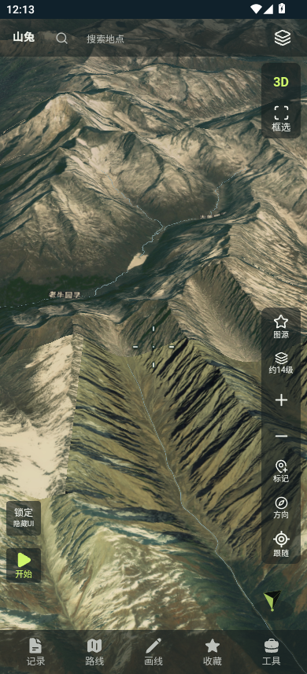

# 原生143：停手高CPU、内存与3D复测

用户要求继续定位原生142在MuMu停手后约54%四核CPU的问题，修复内存与3D卡顿后按相同条件复测。保留原私人141/code148和142/code149作为基线，新候选143/code150沿用原包名、签名、私人天地图和React界面，未更改画质、图源、地形、道路或标签开关。

## 已验证的原因

对原交付142的独立MuMu实例3进行线程观察、ART采样和只读缓存计数，再用临时进程内调整做因果实验。诊断时的注入/扩容不算候选性能数据；正式比较必须冷启动实际构建的新APK并确认无注入映射。

1. **可见纹理工作集大于缓存，静止时反复解码。**512MiB堆下，原预算给每个WorldWindow约85.3MiB；同样390×857、高清、55°的不同视角驻留资源约108.7–162.2MiB。原计数每3秒增加约260–290次瓦片解码，DEM revision不变、网络待加载为0，说明不是持续下载或DEM更新。仅临时扩大纹理缓存后，解码计数21499保持不变，资源用量稳定约113.9MB。首个128MiB候选在另一视角仍反复解码，已明确判为未通过。最终候选按heap/2且最大192MiB限制，容量不是预分配；没有将诊断用256MiB上限写入正式代码。
2. **道路几何也在反复驱逐和组装。**保留原纹理改善后，道路层容量32，loaded约27–31、pending约25–28始终存在，mvt-assembly仍高CPU。临时允许更多驻留后，loaded稳定60、pending归零。全部57个应用线程转为休眠，RSS从此前约374MiB回落到约257MiB。这是单次诊断现象，不能当作正式峰值PSS或FPS。
3. **缓存文件名生成放大了抖动开销。**约9.4秒ART采样中，`cacheFile`调用链累计约4.48线程CPU秒，大量进入`Formatter`、`DecimalFormatSymbols`和ICU Currency初始化。它原本对SHA256每个字节调用`%02x.format`。现在改为直接查表转小写hex，保持UTF-8、SHA256、旧文件名和缓存有效期完全兼容。

4. **拖动期间重复采样重叠的DEM瓦片。**修好静置循环后，192MiB中间候选仍仅约12FPS；拖动ART采样热点落在桥接高程的sampleMercatorTile/readTerrarium。最终候选将每张256²图像一次getPixels复制到数组，内层不再逐点跨JNI读取；同一地图的64阶桥接网格按瓦片ID/输出大小复用，最多64项、原始写入后30秒到期，不缓存失败结果，不改变高程优先级/精度。缓存内JSON发布后只读，按项目生命周期释放。

这些证据将主要持续负担定位到缓存容量小于当前可见工作集引起的读取/解码/组装反馈，不把原先怀疑的DEM循环直接当作根因。固定级别rasterLevel为null，所以固定级别轮询也不是本基线的原因。

## 修改范围

- `NativeRenderMemoryBudget`：有界纹理工作集容量；矢量驻留预算从每8MiB堆一块、12–32上限改为每2MiB堆一块、32–256上限。256为SDK默认级别的数量上限，不代表所有瓦片预分配。
- `NativeCartographyLayers`：道路名和地名采用同一有界预算计算，不再额外压到24块。各图层独立持有缓存，因此多图/密集城区的累计内存仍需实测，不将块数上限等同字节上限。
- `NativeTerrariumCoverage`、`NativeReactMapHost`、`NativeBridgeDemTileCache`：批量像素读取和有界、短时桥接高程网格复用；SDK自身的地形转换旧路径保留。
- `BoundedTileNetwork`：无地区格式化的SHA256 hex生成，网络并发、天地图节流、TTL和数据格式保留。
- 包含此前尚未出包的DEM标量插值、固定级别拼图预算、吸附关闭时跳过地形射线候选；它们不能单独解释本次自动级别的循环，但随143一并回归。
- `config/product.ts`升级0.2.143-test/code150。原交付包和用户存档保留；不更改React业务或UI。

## 候选验证

- PASS：最终`:hybrid:testDebugUnitTest`及`:hybrid:assembleDebug`，176项，0失败/错误/跳过。
- PASS：CRC2178项、1925份fresh React资源、私人Key存在且React/native匹配、图源配置一致、4份64位ELF16KiB与zipalign；原4a94证书v2签名。
- 最终精确APK：0.2.143-test/code150，180540421字节，SHA256 `92dc0c534fc09578194b60dca18b41352aede347736c62bfb50faa6be4734a1f`。前两个同版本候选只是本机隔离实验，未对用户交付；不能混入最终结果。
- 调试注入只用于预设并核验场景，随后force-stop并冷启动新测量进程；各场景检查maps没有Frida，采样期间不注入或使用临时反射扩容。
- 高DPI静态核对：WorldWind Android setupViewport传入displayMetrics.density，Tile.mustSubdivide将其乘入阈值，与物理viewport的放大抵消。未额外乘host cssScale，不借密度修正降低原高清设置。
- 原固定142 APK哈希再次核对不变。

## 同条件复测

沿用[原141/142协议](mumu-web-native-performance-20261029.md)：同一MuMu实例、4虚拟核/4GiB、390×857、TDT影像高清、地形/道路/注记开启、中心102.9/31、zoom12、俯仰0°和55°、每场景32次设备端连续swipe。候选各跑两轮，第二轮延长静置；PSS为主进程+所属WebView renderer，CPU100%表示四核全部占满。保留每轮和实际手势/SF窗口，不用单次最高FPS。

最终候选两轮共140次有效进程采样。以下CPU为按采样窗口时间加权的四核归一化均值；慢帧采用与原报告一致的≥54ms直方图桶。

| 轮次 | 俯仰 | 拖动PSS中位/峰值 MiB | CPU均值 | FPS | 慢帧 |
|---|---|---|---|---|---|
| native143-r1 | 0° | 412.9 / 439.6 | 60.5% | 36.3 | 9.5% |
| native143-r1 | 55° | 417.3 / 452.9 | 51.5% | 21.6 | 20.2% |
| native143-r2 | 0° | 403.6 / 439.2 | 60.0% | 35.1 | 10.5% |
| native143-r2 | 55° | 437.9 / 468.2 | 51.8% | 29.4 | 8.8% |

第二轮拖动后静置：18次采样，首末间隔57.9秒；PSS 405.0→368.2 MiB，峰值405.0 MiB；CPU时间加权均值2.0%，窗口中位数0.1%。均值包含短暂脉冲，因此不能把约0.1%的中位数写成整个阶段的平均CPU。

| 指标 | 原网页141 | 原生142 | 修复原生143 |
|---|---|---|---|
| 平视拖动峰值PSS MiB | 307–313 | 492–562 | 439–440 |
| 55°拖动峰值PSS MiB | 327–338 | 473–576 | 453–468 |
| 55°呈现FPS | 21.2–30.3 | 6.5–11.1 | 21.6–29.4 |
| 55°慢帧比例 | 11.3–26.3% | 56.2–72.8% | 8.8–20.2% |
| 延长静置CPU均值 | 0.4% | 54.3% | 2.0% |

本次复现的停手后持续高CPU已消除；3D呈现FPS恢复到网页基线观测范围，拖动峰值内存下降。原生143的运行内存仍高于网页141，不能宣称原生已更省，也不能由短测认定手机OOM根因已排除。网页基线跨轮波动明显，本表保留范围，不计算固定性能倍数。

原始样本、设置、无注入检查、手势与SF直方图见[指标目录](../../artifacts/performance/mumu-143-20261029/)。截图人工核对地形/主图、TDT画面、3D和拖动后静置；仍可见影像瓦片的细节/色调边界，未把本次性能通过扩大为全视觉验收。原生与网页并非像素级同画面比较。

## 边界

本次是MuMu模拟器验证，不能代替Find X8的触控、实际1256×2760渲染负担、长时运行和系统退出日志。缓存容量是每个窗口的上限，实际使用随画面变化；其它视角和密集城区可能需要不同工作集，不宣称所有负载均已解决。私人Key不写日志/源码、不公开私人APK；系统服务、保存格式和旧存档不变。

本轮跨2026-10-29/30执行，中间按用户要求暂停。原141/142数据为先前两轮，最终143为恢复后两轮，缓存/网络与宿主调度未完全隔离，不能当作实验室稳定提速倍数。176项定向逻辑测试与主图性能/截图已验证；双图、固定级别、分享的最新组合和完整UI状态未在本轮复验。

本机私人性能测试包为`APK/Shantu-0.2.143-test-private.apk`，固定入口`APK/山兔手机.apk`继续保留原142，既有归档未覆盖；没有公开APK或发布新Release。测试包可覆盖同签名山兔测试版，先保存未落盘草稿；是否在Find X8上解决卡顿/退出仍需实际测试。
